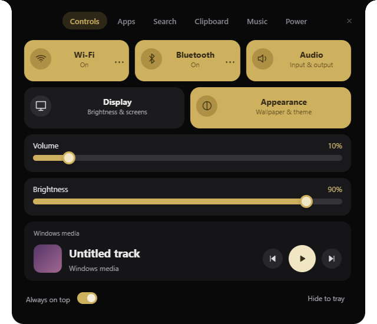
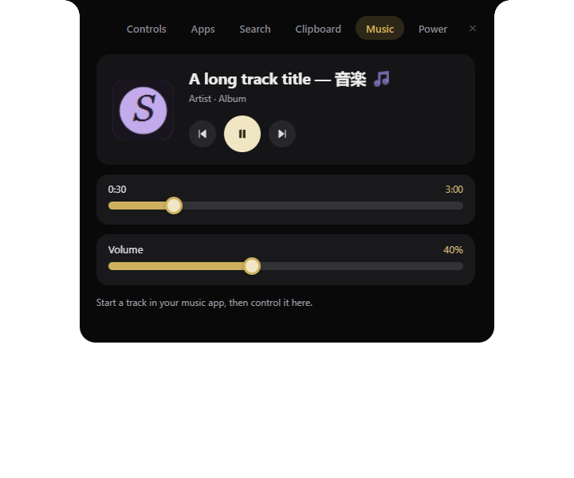
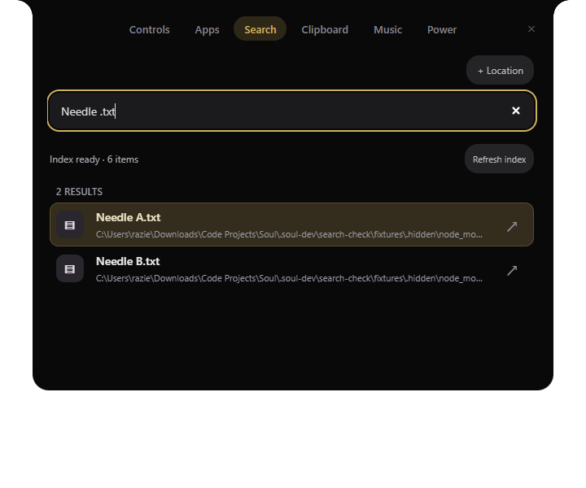
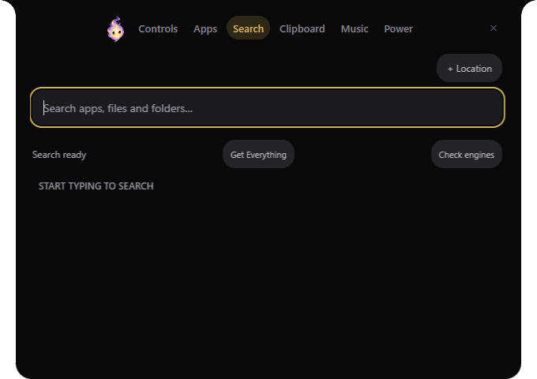

# Soul

**Your Windows essentials, one shortcut away.**

Soul is a fluid, edge-attached Windows desktop toolbar for apps, file search, clipboard history, music, volume, brightness, settings, and power controls. It brings everyday tools into a compact black-and-gold island that opens from the top of your screen.

Inspired by Hitodama's interaction style, Soul is an independent implementation with its own source code, branding, and assets. **No AI, accounts, API keys, or cloud services are required.**

**Version:** 0.3.3 · Early Windows desktop build

## Preview

### Controls



### Music



Screenshots come from the verification harness. Music uses example metadata and Soul's icon as artwork; real music information comes from your active Windows media player. Controls uses simulated music information with local system-control readings.

### Search



Search opens from the shortcut with keyboard focus. This screenshot uses isolated test files, not personal search results.

### Living flame



This verification screenshot uses simulated playback with local system readings.

## Contents

- [Features](#features)
- [Requirements](#requirements)
- [Getting started](#getting-started)
- [Everyday usage](#everyday-usage)
- [Clipboard history and privacy](#clipboard-history-and-privacy)
- [Music integration](#music-integration)
- [Brightness and screen dimming](#brightness-and-screen-dimming)
- [Building](#building)
- [Testing](#testing)
- [Architecture](#architecture)
- [Troubleshooting](#troubleshooting)
- [Limitations and deferred work](#limitations-and-deferred-work)
- [Contributing](#contributing)
- [Credits and licensing](#credits-and-licensing)

## Features

| Area | What Soul does |
| --- | --- |
| Desktop island | Opens directly into Search, attaches to the top edge, and hides when you click outside. |
| Mascot | A living soul flame beside the tabs: idle, curious and search-thinking states; click to pause/wake. |
| Motion | Interruptible spring expansion, fading dismissal, connected tab transitions, morphing play/pause icons, and soft button feedback. |
| Apps | Discovers Start Menu shortcuts and Windows apps; lets you star apps or add `.exe` and `.lnk` shortcuts. |
| Search | Ranks apps and queries Everything or Windows Search; extra folders use bounded on-demand search. |
| Clipboard | Keeps optional, encrypted history of text, formatted text, images, and copied file paths. |
| Music | Shows title, artist, album, and artwork; supports transport controls and seeking where the player allows it. |
| Volume | Reads and changes the default Windows audio output volume. |
| Brightness | Uses built-in display brightness or DDC/CI, with a labelled software-dimming fallback. |
| Wireless | Turns Wi-Fi and Bluetooth radios on or off; separate settings buttons open network selection and device pairing. |
| Settings | Opens Windows display, sound, appearance, and power settings; includes an always-on-top preference. |
| Power | Offers confirmed lock, restart, and shutdown actions, plus cancellation of a pending Windows shutdown. |
| Tray | Keeps Soul accessible while hidden; provides Show and Quit actions. |

There is no separate floating media-player window. Music lives inside the main island.

## Requirements

### Running a packaged build

- A modern Windows desktop environment. Development and native integration checks were performed on Windows 11 x64; Windows 10 configurations have not been fully verified.
- The installed application, or the **entire** `win-unpacked` folder when using the portable build.
- Windows PowerShell and the Windows services used by audio, media, radios, and clipboard integration.
- A compatible display for hardware brightness, or the software-dimming fallback.

### Development

- Windows with Node.js and npm. This project was tested using Node.js 24.12.0.
- Git to clone the repository.
- Internet access during dependency installation and required Electron build-tool downloads.

Dependency versions are recorded in `package-lock.json`.

## Getting started

### Run from source

```powershell
git clone https://github.com/marmalade1124/Souls.git
cd Souls
npm ci
npm start
```

Soul opens at the top of the primary display and adds an icon to the system tray.

### Install Soul

Build the installer with `npm run installer`, then open:

```text
dist/Soul-Setup-0.3.3.exe
```

The setup wizard supports choosing an installation directory, creates desktop and Start Menu shortcuts, and includes an uninstaller. It defaults to a per-user installation. The installer is unsigned and has not yet been published as a GitHub release.

### Run a packaged build

After building, open:

```text
dist/win-unpacked/Soul.exe
```

Keep the full `win-unpacked` directory together. Moving only `Soul.exe` will omit required Electron files and resources.

Packaged binaries are excluded from this source repository. These instructions do not assume a downloadable release or installer has been published.

## Everyday usage

### Show, hide, and quit

| Action | Result |
| --- | --- |
| `Ctrl + Shift + Space` | Opens Search with the input focused and existing text selected, including while hidden. |
| Click outside Soul | Hides the complete island. |
| `Esc` or upper-right × | Hides the island. |
| Hide to tray | Hides without quitting. |
| Tray icon | Shows or hides Soul. |
| Tray menu → Quit Soul | Exits and removes any screen-dimming overlay. |

Drag the blank space around the tabs horizontally to reposition the island. It stays attached to the top edge. Windows file pickers and confirmation dialogs keep the island open while you complete the operation.

The shortcut is currently fixed. If another application reserves it, use the tray menu to show Soul.

### Mascot

The flame beside the tabs reacts briefly to navigation and animates while a search is pending. Click it (or focus it and press Enter/Space) to pause or wake it; this preference is stored locally. Drawings blend over 180 ms while subtle breathing uses compositor-driven opacity/transform animation at the display refresh rate (60 fps on a 60 Hz display, when the system can sustain it). The source sheet still has six drawings per state, not 60 unique drawings. Idle motion plays briefly, then rests. All frame timers stop when the island closes, and reduced-motion mode uses a still frame. It does not use AI or track your screen.

### Controls

- Click **Wi-Fi** or **Bluetooth** to toggle that radio.
- Use its **⋯** button to select a network or manage Bluetooth devices in Windows settings.
- Drag **Volume** or **Brightness** to adjust it. Range controls also provide standard keyboard interaction.
- If hardware brightness is unavailable, the second slider becomes **Screen dimming**.
- Open **Audio**, **Display**, or **Appearance** for the corresponding Windows settings page.
- Toggle **Always on top** to change whether Soul stays above other ordinary windows.

Permissions, enterprise policies, airplane mode, missing adapters, or physical switches can prevent radio changes. Soul displays a failure message instead of claiming success.

### Apps

1. Open **Apps** and search for an installed application.
2. Click its name to launch it.
3. Use its star button to pin or unpin it.
4. Use **+** to add a local executable or Windows shortcut.

Starred apps appear first. Discovery runs at startup and combines Start Menu shortcuts with Windows app registrations. Restart Soul after installing an app if it has not appeared yet. The visible list is limited, but filtering searches the discovered collection.

### Search

1. Press **Ctrl + Shift + Space** and start typing immediately.
2. Search an app name, filename, or words from a file's path. App matching supports fuzzy names; native file queries match words in paths.
3. Use **↑ / ↓** to choose a match and **Enter** to open it. Soul hides after a successful launch.
4. Use a result's reveal button to locate it in Explorer.

Soul queries an existing native index instead of building a duplicate whole-drive index:

- **Everything first:** install [Everything](https://www.voidtools.com/downloads/) and keep its standard/default application running in the background. Its service alone is insufficient for SDK queries. Coverage depends on Everything's configured volumes and folders, and its initial index may need time to finish.
- **Windows Search fallback:** works without Everything when Windows Search is available. Only locations indexed by Windows are covered. Configure coverage in Windows **Searching Windows / Indexing Options**.
- **Extra locations:** use **+ Location** for a specific folder or share outside native coverage. These are searched only when you type, with a two-second/15,000-entry traversal budget. Broad extra locations can yield incomplete results; narrow them when the limit is reached.

The Search panel shows the active engine. **Get Everything** opens its official download page; Soul does not install it automatically. **Check engines** probes availability without rescanning drives. Results include at most 100 files/folders and up to 20 apps. Only one native query runs at a time; typing replaces queued searches and ignores obsolete responses.

Soul no longer loads or writes `file-index.ndjson`, watches entire drives, or runs periodic full rescans. Existing old cache files are left untouched and unused. Preferences, pins and clipboard history are preserved. This removes Soul's duplicate indexing work; Electron and the external indexing engine still consume resources. No numerical CPU/RAM improvement has been benchmarked.

File search uses names and paths, not contents. Native coverage and Windows permissions still apply. Explicit-folder traversal avoids following symbolic-link targets, limits reads, and supports cancellation. Offline, protected or disconnected locations may remain unavailable. When both engines are unavailable, apps and explicitly added locations remain searchable.

### Power

Lock, restart, and shutdown ask for confirmation. Restart and shutdown have a **60-second delay** so you can save your work. Use **Cancel a pending restart or shutdown** to request cancellation.

Cancellation affects a pending Windows shutdown even if another application scheduled it. **Sleep settings** opens the Windows power page; it does not immediately put the computer to sleep.

Further power improvements and expanded multiple-monitor support are deferred.

## Clipboard history and privacy

History is **off by default**. Enable it in the Clipboard tab when you want Soul to retain copied content.

### Supported content

| Format | Behavior |
| --- | --- |
| Plain text | Shows a preview and restores the original supported payload. |
| HTML / RTF | Retains formatting for compatible destination apps; HTML is never executed or rendered in Soul. |
| PNG / JPEG | Shows an image preview and restores image data. |
| Explorer file copies | Retains file-copy paths; it does not back up the files themselves. |

Click **Copy** beside an entry, then paste into your destination app. You can delete individual entries or clear Soul's saved history.

### Limits

- Up to **40 entries**.
- Up to **4 MiB of supported payload per captured copy**; formats exceeding the remaining budget are skipped.
- An approximately **16 MiB serialized-history budget**, measured by serialized string length; older entries are removed as it fills.
- Text previews show at most **20,000 characters**.
- Arbitrary application-specific formats are excluded.

History captures the existing clipboard when enabled and continues while Soul is hidden. Windows notifications trigger captures, with polling as a fallback. Very rapid copy bursts or clipboard contention may prevent every intermediate copy from being retained.

### Storage and privacy

Preferences normally live in:

```text
%APPDATA%/soul-island/preferences.json
```

Clipboard history is encrypted with Electron `safeStorage`, backed by Windows DPAPI. Pins, search roots, and ordinary preferences are stored as local JSON fields. Writes use temporary-file replacement. Transient failures preserve active changes in memory and trigger retries; unreadable data is retained as a recovery copy where possible.

Encryption does not prevent content from being visible while you are signed in and viewing Soul. Pause history before copying passwords, authentication codes, or anything you do not want saved.

Soul's history is separate from **Win + V**. Clearing Soul's history does not clear Win + V and does not erase the active system clipboard.

### Isolated development profile

```powershell
$env:SOUL_DEV_DATA = Join-Path $PWD '.soul-dev/manual-profile'
npm start
```

Return to the normal profile by removing the variable:

```powershell
Remove-Item Env:SOUL_DEV_DATA
```

## Music integration

Soul uses Windows' Global System Media Transport Controls APIs.

- The active player supplies title, artist, album, artwork, playback state, and timeline information.
- Artwork is read locally and bounded to 1 MiB; Soul does not fetch album images from external services.
- Play/pause icons follow the player's reported state.
- Previous, play/pause, and next use Windows media controls.
- Seeking is available only when the player exposes it.
- Seek requests include session and track identity, preventing obsolete requests from silently targeting a different track.

Start playback in your preferred player first. Missing artwork uses a placeholder. Live streams, unsupported players, and empty sessions show a disabled timeline or empty-player state. Players without a Windows session may still respond to transport keys, but cannot provide metadata to Soul.

When multiple players are active, Windows determines the current session. A dedicated player selector is not implemented.

## Brightness and screen dimming

Soul tries native brightness through built-in display interfaces, then DDC/CI for a compatible external display. Enable **DDC/CI** in the monitor's physical settings menu if supported.

If hardware control is unavailable, **Screen dimming** uses a transparent, click-through black overlay on the primary display. It does not intercept pointer input or take keyboard focus.

Dimming changes perceived brightness, **not the backlight**, and does not provide hardware brightness's battery savings. Set it to 100% or quit Soul to remove the overlay. Behavior over exclusive fullscreen applications and the Windows secure desktop is not fully verified.

Separate per-monitor brightness controls are not implemented.

## Building

```powershell
npm ci
npm test
npm run pack
npm run installer
```

The build creates:

```text
dist/
└── win-unpacked/
    ├── Soul.exe
    ├── resources/
    └── ...required Electron files
```

Source is packaged in an ASAR archive. Native PowerShell helpers are unpacked into resources so Windows can execute them.

`npm run pack` creates the unpacked directory; `npm run installer` builds the NSIS setup executable. An auto-updater is not configured. The project does not configure a production code-signing identity; Windows may warn about the unsigned installer. The interactive install/uninstall wizard has not been exercised on a clean machine.

### Broken npm launcher

If npm's shim is broken but Node.js is installed normally, call npm's entry point directly. Adapt the paths to your installation:

```powershell
& 'C:\Program Files\nodejs\node.exe' `
  'C:\Program Files\nodejs\node_modules\npm\bin\npm-cli.js' start
```

Replace `start` with `ci`, `test`, or `run pack` as needed.

## Testing

### Unit tests

```powershell
npm test
```

The current suite has **22 passing tests** covering helper lifecycle and timeouts, search limits and cancellation, preference validation, clipboard formats, history budgets, and malformed payloads.

### Electron checks

Run from the project root:

```powershell
npx electron scripts/check-ui.cjs
npx electron scripts/check-features.cjs
npx electron scripts/check-search.cjs
npx electron scripts/check-edge-cases.cjs runtime
```

Additional preference/display cases:

```powershell
npx electron scripts/check-edge-cases.cjs corrupt
npx electron scripts/check-edge-cases.cjs cipher
npx electron scripts/check-edge-cases.cjs display
```

Scripts use isolated profiles under `.soul-dev/` and write results, logs, or screenshots there. `check-search.cjs` exercises real bounded traversal against isolated fixtures with a simulated native provider; `check-search.cjs --packaged` loads the built ASAR source. Other UI harnesses substitute search to avoid reading personal files. Native Windows Search is checked separately against the real helper. Feature checks simulate native controls and clipboard contents. UI checks substitute clipboard and transport operations while reading local system controls. Power checks are mocked and do not shut down the computer.

### Real clipboard verification

Stop the normal Soul app before running:

```powershell
npx electron scripts/check-clipboard-live.cjs
```

This temporarily writes sample text, images, formatted text, and file-copy data to the real clipboard. It materializes and restores the original formats afterward. Win + V may retain test entries independently.

### Verified behavior

- Unit suite and isolated Electron UI, feature, and robustness checks.
- Real Windows text capture while visible and hidden.
- Real PNG, HTML, and file-copy round trips.
- Active Brave metadata, artwork, and timeline reads.
- Native seeking at the existing playback position.
- Radio enumeration and a Bluetooth request retaining its existing on state.
- Packaged-source comparison against the delivered implementation.
- Native-provider service tests: no default filesystem crawl, explicit-folder bounds, deduplication, query coalescing/cancellation and unavailable-engine fallback.
- Real Windows Search helper probe and bounded filename query.
- Search startup focus, registered shortcut callback, Arrow/Enter selection and launch, engine checks, and packaged-source loading.

Other players, wireless reconnection cycles, physical monitor changes, and long-running hardware behavior still need testing. See [QA.md](QA.md) for the detailed record.

## Architecture

Soul uses Electron with plain HTML, CSS, JavaScript, and PowerShell helpers. There is no frontend framework or additional runtime npm dependency.

```text
Renderer → Explicit preload API → Electron main process
                                  ├── Windows, tray and shortcuts
                                  ├── Clipboard and encrypted preferences
                                  ├── Apps and native indexed search
                                  └── Persistent Windows helper
                                      ├── Audio volume
                                      ├── Brightness / DDC/CI
                                      ├── Media metadata and seeking
                                      └── Wi-Fi / Bluetooth radios
```

| File | Responsibility |
| --- | --- |
| `src/main.js` | Lifecycle, validated IPC, window shape, clipboard, dialogs, persistence, and system actions. |
| `src/preload.js` | Explicit context-isolated renderer API. |
| `src/mascot.js`, `src/assets/soul-flame-sheet.png` | Local sprite playback, pause preference, reduced motion and visibility handling. |
| `src/renderer.js` | Tab state, motion, transport icons, sliders, metadata, app lists, and clipboard rows. |
| `src/index.html` | Island structure and accessible controls. |
| `src/style.css`, `src/fluid.css` | Base styles and current black-and-gold design. |
| `src/controls.js` | Worker protocol, request IDs, matching responses, timeouts, and restarts. |
| `src/controls.ps1` | Native audio, brightness, radio, media, artwork, and seeking integration. |
| `src/media.ps1` | Windows media-key dispatch. |
| `src/clip-formats.js` | Clipboard payloads, previews, keys, validation, and budgets. |
| `src/preferences.js` | Preference and history sanitization. |
| `src/library.js` | App discovery and bounded explicit-folder traversal. |
| `src/search-service.js` | Native queries, coalescing, cancellation and explicit-folder fallback. |
| `src/search.ps1`, `src/native/Everything64.dll` | Local Everything SDK IPC and Windows Search SQL queries. |
| `src/search-match.js` | Shared app/file relevance matching. |
| `tests/`, `scripts/` | Unit tests and Electron verification. |

The transparent native window remains a stable canvas while the visible island and its input region change. This avoids native resizing every animation frame. Motion can be interrupted; reduced-motion preferences are respected.

The renderer uses context isolation, sandboxing, and no Node.js integration. IPC is restricted to the owned main window/frame and explicit validated actions. Main-window navigation and new windows are blocked. Soul has no telemetry or cloud API calls. Searching network shares may generate ordinary filesystem network traffic.

Project knowledge outputs are in [`graphify-out/`](graphify-out/). The graph is a navigation aid, not proof of correctness. Its report and audit files document extraction limitations.

## Troubleshooting

| Problem | What to check |
| --- | --- |
| Shortcut does not work | Use the tray menu; another app may reserve it. |
| App is missing | Restart after installation, search its name, or add an executable/shortcut manually. |
| Search is empty or incomplete | Check the engine label, run Everything or configure Windows indexed locations, add a specific folder, and refine the query. Protected/offline locations remain unavailable. |
| Clipboard entry is missing | Enable history, check formats and limits, and retry after clipboard contention. |
| Win + V differs | The two histories are independent. |
| Artwork/title is missing | Use a player that exposes a Windows media session; missing artwork gets a placeholder. |
| Seeking is disabled | The player or stream does not expose a seekable timeline. |
| Wireless toggle fails | Check adapter availability, airplane mode, permissions, hardware switches, and policies. |
| Brightness is unavailable | Enable DDC/CI where supported, or use Screen dimming. |
| Display remains dim while Soul is hidden | Hiding does not quit. Set dimming to 100% or quit from the tray. |
| Preferences cannot save | Check access to the user-data folder; active changes remain in memory during retries. |
| History cannot decrypt | Account/DPAPI changes may invalidate it; a recovery copy is retained where possible. |
| Moved executable fails | Keep the full `win-unpacked` folder and resources together. |

## Limitations and deferred work

- **Power enhancements and expanded multiple-monitor support are deferred.** Existing confirmed power actions remain available.
- Physical hot-plugging, mixed DPI, rotation, and primary-display changes are not fully verified.
- Radio tiles toggle power; network selection and Bluetooth pairing use Windows settings.
- Brightness varies by hardware; dimming is a visual fallback, not universal backlight control.
- Clipboard file entries retain paths, not contents; missing files cannot be recovered from history.
- Custom clipboard formats and oversized payloads may be omitted.
- There is no player selector; media behavior depends on the current Windows session.
- App discovery and the shortcut are not configurable in a preferences screen. Search uses filenames/paths, not contents; coverage depends on the native engine and bounded extra-location traversal.
- The installer is available locally, but interactive installation/uninstallation on a clean machine remains unverified. Auto-update, launch-at-login, and production signing configuration are not provided.
- Long-duration use, actual sleep/resume, Remote Desktop clipboard behavior, and additional hardware failures need testing.

Soul is an early functional app, not a claim of universal hardware compatibility.

## Contributing

1. Clone or fork the repository and install with `npm ci`.
2. Use an isolated profile for clipboard and preference changes.
3. Preserve the existing design and native integration conventions.
4. Run unit tests and relevant Electron checks.
5. Report the Windows version, reproduction steps, expected behavior, and actual behavior with bugs.

Do not commit personal clipboard contents, user-data profiles, credentials, or generated test logs. Dependencies, build output, and `.soul-dev/` are ignored.

## Credits and licensing

- Visual and interaction inspiration: [Hitodama](https://hitodama.in/buy/).
- Desktop runtime: [Electron](https://www.electronjs.org/).
- Packaging: [electron-builder](https://www.electron.build/).
- Native integration: Windows COM, WinRT, audio, display, and radio APIs.
- [Everything SDK](https://www.voidtools.com/support/everything/sdk/): bundled x64 DLL from the official SDK archive, with its [MIT-style license](src/native/LICENSE-Everything-SDK.txt). Everything itself is not bundled. DLL SHA-256: `81B5BE18126ACD2C2B913F8F4A821E476B18393CDD3DEBD03387C50AFD8DB88F`.

Soul is not affiliated with Hitodama and does not include its software, artwork, or AI features.

No project license has been selected yet. Third-party dependencies retain their own licenses.
